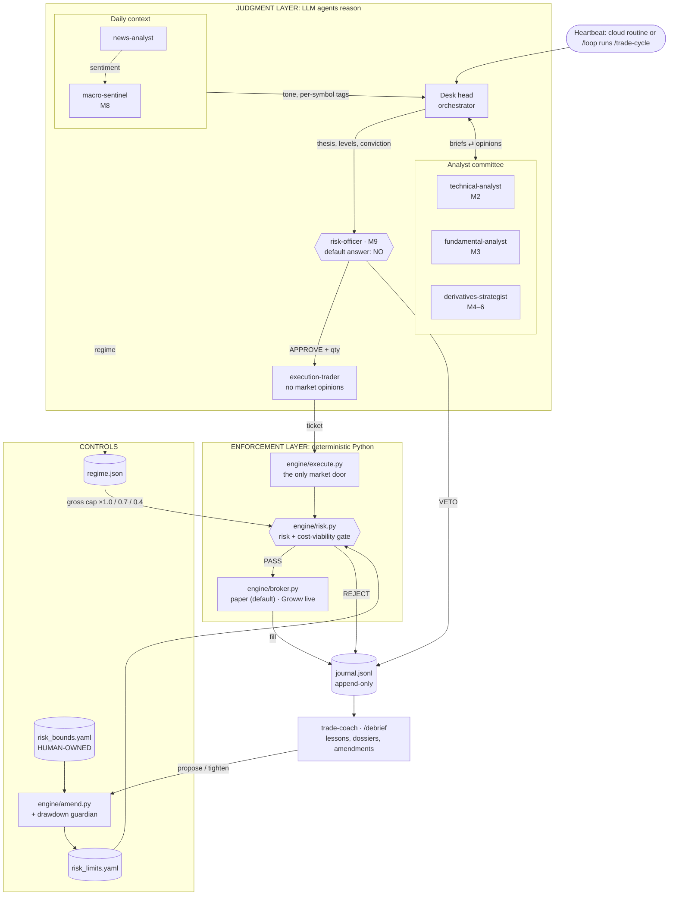
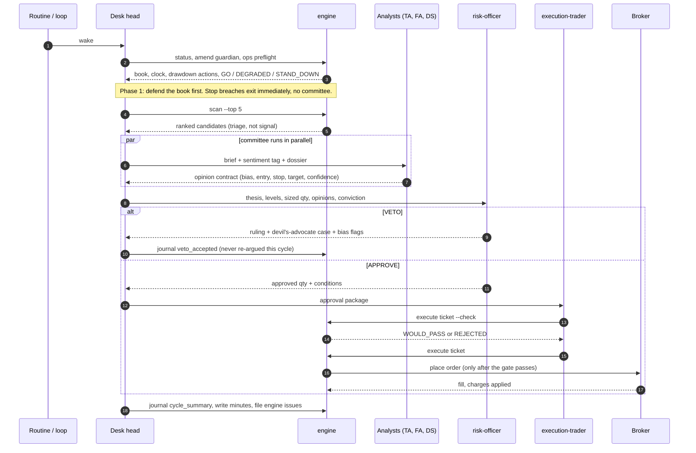
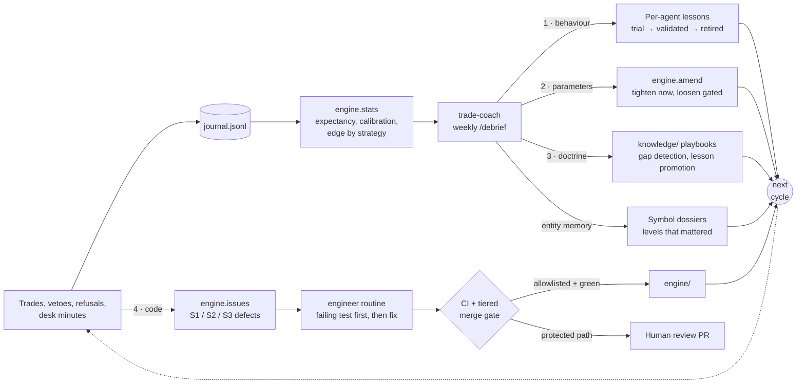
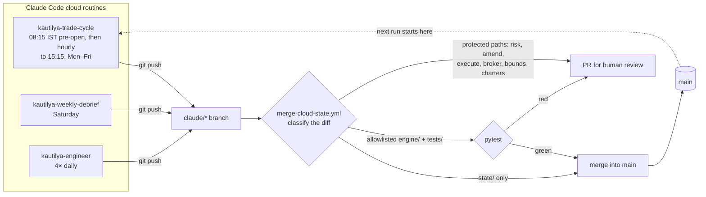

# KAUTILYA — a self-evolving trading firm in miniature

> *Named for Kautilya (Chanakya), author of the Arthashastra, the ancient Indian
> treatise on statecraft, economics and the discipline of power.*

KAUTILYA is an autonomous swing-trading desk for NSE equities, staffed by AI
agents and governed by deterministic code. It is organised like a real trading
firm: analysts who argue, a risk officer whose default answer is *no*, an
execution trader who has no opinions, a coach who reviews every week, and an
engineering function that fixes what breaks. Its doctrine comes from the
[Zerodha Varsity](https://zerodha.com/varsity/) curriculum, distilled into
playbooks each agent reads before it acts.

The firm is built to **get better on its own**. It does not retrain a model. It
improves the way a real firm does: it keeps a journal it cannot edit, runs
post-mortems, writes down what it learned, retunes its own risk limits, grows
its doctrine, and files engineering tickets against its own code. A
human-owned "constitution" sets the outer limits that none of this can cross.

---

## Contents

- [Purpose](#purpose)
- [What "self-evolving" means here](#what-self-evolving-means-here)
- [System design](#system-design)
  - [The two-brain rule](#the-two-brain-rule)
  - [Architecture](#architecture)
  - [One trade cycle](#one-trade-cycle)
  - [The evolution loops](#the-evolution-loops)
  - [Memory tiers](#memory-tiers)
  - [Deployment](#deployment)
- [The desk](#the-desk)
- [Safety model](#safety-model)
- [Getting started](#getting-started)
- [Repository map](#repository-map)
- [Honest scope](#honest-scope)

---

## Purpose

Most "AI trader" projects ask a model for a prediction and place the order. The
model's judgment and the firm's controls end up being the same thing, and when
the model is wrong there is nothing between it and the money.

KAUTILYA tests a different idea: **the edge a small, slow desk can have is
discipline, and discipline is a system you can build.** Concretely:

1. **Several lenses on every trade.** Technical, fundamental, derivatives, macro
   and news specialists each give an opinion in a fixed format, with a
   falsifiable thesis and a 0–100 conviction score.
2. **Review designed to kill trades.** A risk officer tries to talk the desk out
   of every proposal: it runs a bias scan, writes a devil's-advocate case, and
   its veto is final.
3. **Risk math the LLMs cannot override.** Every order goes through
   `engine/execute.py` and a Python risk gate that checks every limit again, net
   of real transaction costs, whatever any agent says.
4. **A journal it cannot dodge.** Every fill, veto, refusal, regime change and
   ops alert goes into an append-only journal. The coach scores the desk's
   calibration against what it actually said at the time.
5. **Compounding improvement.** What the desk learns from the journal flows back
   into its behaviour, its risk limits, its doctrine and its code, through
   gates that make it easy to cut risk and hard to add it.

The desk is sized for **₹10,000 of real capital on Groww** and runs in **paper
mode** until it meets an evidence-based graduation bar (see
[Safety model](#safety-model)). At this size, transaction costs are the first
adversary, so every paper fill pays the full Groww charge model.

---

## What "self-evolving" means here

The firm changes itself through four separate feedback loops. Each one has an
owner, a cap and a gate.

| Loop | What changes | Who changes it | How it's gated |
|---|---|---|---|
| **1. Behaviour** | Per-agent lessons in `state/lessons/<agent>.md` | trade-coach, at `/debrief` | Max 12 active lessons per agent; each must be falsifiable and cite evidence; lifecycle `trial → validated → retired` checked against later trades |
| **2. Risk parameters** | `state/risk_limits.yaml` | risk-officer / coach via `engine.amend`; drawdown guardian automatically | **Tighten:** instant. **Loosen:** ≥20 closed trades, expectancy ≥ 0.1R, step ≤25%, 24h cooling a human can veto, ≥14 days apart. Always inside the human-owned `risk_bounds.yaml` |
| **3. Doctrine** | `knowledge/` playbooks | coach proposes, human approves, `/distill-modules` builds | Doctrine gaps are named only when ≥3 losses share a failure no playbook covers; lessons validated for 90+ days get proposed for promotion into the playbook |
| **4. Code** | `engine/` and `tests/` | the desk *files* defects; a separate engineer routine *fixes* them | Traders never edit engine code. Fixes start from a failing test. CI decides the merge, and protected paths (risk gate, execution, broker, amendments, charters) always go to a human PR |

Alongside these, the desk keeps **entity memory**: per-symbol dossiers
(`state/dossiers/`, capped at 80 lines) that record support and resistance
levels that held or broke, grade history and red flags. A dossier line is
judged by what the market did next, not by how many sources agree with it.

**What never evolves:** `state/risk_bounds.yaml` (the envelope), `capital_base`,
`stop_required` and `slippage_bps`. Agents are blocked from writing the bounds
file in `.claude/settings.json`, and the merge workflow sends any change to it
to human review. The firm improves inside limits that a human owns.

### Evolution in practice

From the desk's own record (snapshot as of the last cloud run, 2026-08-11):

- **It caught its own sizing blind spot and tightened itself.** Reviewing the
  first position (M&M), the risk officer found the entry had been set to land
  exactly on the 1% per-trade risk cap. Once slippage and charges were added,
  the true risk was about 1.33%. The same morning it ran
  `engine.amend tighten risk_per_trade_pct 1.0 → 0.75`, with the reasoning
  saved in `state/amendments/history.jsonl`.
- **It learned what its capital can't buy.** After the cost gate vetoed
  SUNPHARMA (round-trip charges were 58–63% of the expected gain), the coach
  issued a desk lesson: at ₹10k, names priced above roughly ₹1,750 are close to
  untradeable. The watchlist was rebalanced toward names it can actually afford.
- **It scores itself after costs.** The first closed trade made **+₹24.09
  gross** and **−₹8.02 net** after ₹32.11 of charges. `engine.stats` reports
  the net figure, so the go-live gate judges the real edge, not the gross one.
- **It patches its own judgment while code fixes wait.** The engine doesn't yet
  stop a stop-loss from being lowered (an open, human-gated issue). Until that
  fix lands, the coach issued the risk officer a lesson to check this by hand.
- **It maintains itself.** Trading cycles filed 41 engine defects with evidence.
  The engineer routine closed 15 of them, each starting from a failing test, and
  the test suite grew from 43 to 141 tests between 6 and 11 August 2026.

---

## System design

### The two-brain rule

> **Agents reason. `engine/` enforces. The two never swap roles.**

| | Judgment layer | Enforcement layer |
|---|---|---|
| **Lives in** | `.claude/agents/`, `.claude/skills/` | `engine/` (plain Python) |
| **Does** | Reads charts, grades businesses, weighs news, argues, vetoes, reflects | Prices, sizes, checks limits, routes orders, journals, keeps score |
| **Final word** | The risk officer's **VETO** | The engine's **REJECT** |
| **Can be wrong by** | Bias, overconfidence, hallucination | Only by a code bug, which is why defects get filed and tested |

No order reaches a broker except through `engine/execute.py`, and it checks the
risk gate again no matter which agent sent the order. An approval from the risk
officer is necessary but never sufficient.

### Architecture



### One trade cycle

`/trade-cycle` is the heartbeat. It runs in fixed phases. Exits always come
before entries, and the cycle can open at most two new positions.



| Phase | What happens |
|---|---|
| **0 · Clock, book & guardian** | `engine.status`, `engine.amend guardian`, `engine.ops preflight`. A `STAND_DOWN` verdict (stale state, dead feed) or any open **S1** safety issue blocks new entries. |
| **1 · Defend the book** | Stop breaches exit immediately. If a target is hit or the thesis looks stale, the technical analyst re-reads the chart. Stops can be raised, never lowered. |
| **2 · Capacity gate** | If the circuit breaker has tripped, the book is full, or cash is under 5%, skip straight to Phase 6. Don't window-shop. |
| **3 · Scan & committee** | `engine.scan` ranks the watchlist. The analysts review 1–2 candidates in parallel. Low confidence (<55), a C grade or a `veto_flag` drops a candidate here. |
| **4 · Risk gate** | The risk officer approves with a size, or vetoes. Vetoes are journaled and accepted. |
| **5 · Execute & regime** | The execution trader routes approved tickets. Once a day, the news analyst publishes sentiment and the macro sentinel resets the regime. |
| **6 · Close the loop** | Journal a `cycle_summary`, write the desk minutes (the *reasoning*, max 80 lines), file any engine defects, report to the human. |

### The evolution loops



The loops run at different speeds on purpose. The drawdown guardian runs every
cycle and only ever cuts risk. Lessons and amendments change weekly at
`/debrief`. Doctrine changes rarely and only with human approval. Code changes
whenever a test can prove the fix.

### Memory tiers

Context is a budget. The desk stays coherent over hundreds of cycles because
every tier is capped by code, not by agents promising to be brief.

| Tier | Contents | Access rule |
|---|---|---|
| **T0** `raw/` | Varsity PDFs and extracted text | Never in a trading context. PDF reads are denied in settings; used only for distillation |
| **T1** `knowledge/` | 8 distilled playbooks (~3,400 lines total) | Each agent reads **only its own** playbook, by section |
| **T2** live state | Status, scan, news digest, sentiment, scorecard | Compact JSON generated and capped by the engine |
| **T3** `journal.jsonl`, `equity.jsonl` | The permanent audit trail | Agents only write to it. Reads go through `engine.stats` or a targeted `grep`/`tail`, never a full load |
| **T4** curated memory | `lessons/` (12 per agent), `dossiers/` (80 lines per symbol), `minutes/` (pruned after 30 days) | The only tier the desk writes for itself; the coach maintains it at `/debrief` |

### Deployment

The desk runs on **Claude Code cloud routines**, with the git repository as its
only source of truth. All state, including the journal, limits, lessons and
OHLCV cache, is committed, so every run starts from where the last one stopped.



- **Single writer.** The cloud is the only writer of `state/`. Before touching
  state, a local session runs `git pull`.
- **Merge-safe journals.** `.gitattributes` union-merges the JSONL logs, so
  concurrent runs never lose journal lines.
- **Self-monitoring plumbing.** `engine.ops preflight` checks every cycle that
  the clone is current with `origin/main`, that no `claude/*` branches are
  stranded (a sign the merge workflow is broken), and that the price feed is
  live. Failures are journaled as `ops_alert`, and the weekly debrief audits
  infrastructure as seriously as trades.
- **Resilient data.** `engine/data.py` tries several sources in order: the
  Yahoo chart endpoint, then yfinance, then a git-committed daily-bar cache,
  then Groww live LTP. Every snapshot carries a `source` tag, and the desk may
  only *open* positions on fresh (`yf`) data.

---

## The desk

### Agents (`.claude/agents/`)

| Agent | Doctrine | Job | Output contract |
|---|---|---|---|
| **technical-analyst** | Varsity M2 | Reads the chart: patterns, support and resistance, volume, indicators, Dow phase | bias, entry/stop/target, confidence 0–100 with rubric, invalidation |
| **fundamental-analyst** | Varsity M3 | "Would we hold this if the swing became a long hold?" | quality grade A/B/C, valuation, key risks, `veto_flag` |
| **derivatives-strategist** | Varsity M4, M5, M6 | Picks the best instrument for a view: cash, futures or an options structure | legs, max loss/gain, breakeven, Greeks (cash equity by default) |
| **news-analyst** | Engine RSS digest | Compresses headlines into one sentiment object | tone, per-symbol tags, ≤3 top risks |
| **macro-sentinel** | Varsity M8 | Sets the regime from INR, crude, gold, DXY, VIX and global cues | `risk_on` / `neutral` / `risk_off`, which scales the gross cap ×1.0 / 0.7 / 0.4 |
| **risk-officer** | Varsity M9 | Adversarial gate and steward of the limits (can only tighten) | APPROVE + qty or VETO, checklist, devil's advocate, bias flags |
| **execution-trader** | — | The only agent that calls `engine.execute`; has no market opinions | ticket, then the engine's result verbatim |
| **trade-coach** | Varsity M9 | Weekly debrief: calibration, discipline audit, edge attribution | debrief report, lessons, dossiers, amendments |

Specialists run on Sonnet. The desk head (the orchestrating session) runs on Opus.

### Skills (`.claude/skills/`)

| Command | Purpose |
|---|---|
| `/trade-cycle` | One full wake cycle: the heartbeat |
| `/debrief` | Weekly performance review, where the evolution loops run |
| `/risk-audit` | Book against limits, correlation clusters, 1-day VaR, bias scan of open theses |
| `/go-live` | Gated checklist to move from paper to live Groww orders |
| `/distill-modules` | Rebuild `knowledge/` from source PDFs in `raw/` (works with any source, not just Varsity) |

### Engine (`engine/`)

| Module | Responsibility |
|---|---|
| `execute.py` | **The only market door.** Loads a ticket, checks it against the risk gate, routes it to the broker, journals everything |
| `risk.py` | Deterministic gate: stop required, per-trade risk, minimum R:R, **cost viability** (round-trip charges ≤25% of expected gain), notional cap, cash, max positions, regime-scaled gross cap, daily-loss circuit breaker, approval flag |
| `charges.py` | Groww delivery cost model: brokerage, STT, exchange, SEBI, stamp duty, GST, DP |
| `broker.py` | `PaperBroker` (live quote + slippage + full charges), `GrowwBroker` (live, credentials from env only), `KiteBroker` (legacy) |
| `amend.py` | Limit amendments and the drawdown guardian |
| `data.py` | OHLCV and indicators (RSI, ATR, …) with the fallback chain and `source` tagging |
| `scan.py` | Ranks the watchlist (triage, not signal) |
| `news.py` | RSS digest (ET, Livemint, Moneycontrol, Business Standard), capped at 40 headlines; publishes sentiment |
| `regime.py` | Regime state and gross-exposure multiplier |
| `status.py` | Clock (NSE hours, IST), book, alerts, equity curve |
| `stats.py` | Journal → scorecard: expectancy in ₹ and R **net of charges**, calibration buckets, per-strategy edge |
| `ops.py` | Preflight: state sync, stranded branches, feed check → `GO` / `DEGRADED` / `STAND_DOWN` |
| `issues.py` | Defect channel (S1 safety / S2 correctness / S3 minor), with deduplication; an open S1 blocks new entries |
| `portfolio.py`, `common.py` | Book accounting; IST clock, market status, journal writer |

---

## Safety model

Several independent layers each have to agree before money moves:

1. **Charters.** Each agent's role is narrow. The execution trader can't decide
   to trade, and the analysts can't trade at all.
2. **Adversarial review.** The risk officer defaults to NO. Its veto is final,
   and vetoed ideas aren't argued again in the same cycle.
3. **Deterministic gate.** `engine/risk.py` checks every entry again, net of
   costs. Exits are always allowed; new risk is not.
4. **Human-owned envelope.** `state/risk_bounds.yaml` sets a floor and ceiling
   for every tunable limit. Agents are denied write access in
   `.claude/settings.json`, and any change goes to a human PR.
5. **Asymmetric amendments.** Cutting risk is instant. Adding risk needs
   evidence, a cooling period and the chance of a human veto.
6. **Drawdown guardian.** At 5% below peak equity it halves per-trade risk. At
   10% it drops per-trade risk to the floor and forces `risk_off`.
7. **No data is better than bad data.** Stale or patched quotes mean no new
   entries. A dead feed means stand down and say so.
8. **Separation of duties in code.** Trading sessions file defects but never
   edit `engine/`. The engineer routine can auto-merge only allowlisted modules
   with green tests.
9. **Paper by default.** Live mode needs `/go-live`, a human typing the
   acknowledgement line into `state/broker.yaml`, and credentials kept in
   environment variables only.

### Current limits

| Limit | Current (`risk_limits.yaml`) | Envelope (`risk_bounds.yaml`) |
|---|---|---|
| Risk per trade | 0.75% (₹75) | 0.25 – 2.0% |
| Daily loss circuit breaker | 3.0% (₹300) | 1.0 – 5.0% |
| Max open positions | 3 | 2 – 8 |
| Max position notional | 35% (₹3,500) | 5 – 40% |
| Max gross exposure | 100% × regime multiplier | 20 – 120% |
| Min risk:reward | 2.0 | 1.2 – 3.0 |
| `capital_base`, `stop_required`, `slippage_bps` | ₹10,000 · true · 5 bps | **not amendable** |

### Non-negotiables

1. `risk_bounds.yaml` is human-owned. `risk_limits.yaml` changes **only** through `engine.amend`.
2. Every entry has a stop when the ticket is written. Stops never move down.
3. Only the execution trader calls `engine.execute`, and only on approvals or stop/target exits.
4. A veto is journaled and accepted, with no re-arguing within the cycle.
5. At most 2 new entries per cycle. On stale or failed quotes, stand down.
6. Paper mode is the default. Live mode only through `/go-live`.
7. Every trade carries a falsifiable thesis and a 0–100 conviction score.

### Path to live

`/go-live` requires ≥20 closed paper trades over ≥4 weeks, positive expectancy
after charges, a clean discipline audit, and a recent `/risk-audit` with no
violations. *Planned:* SEBI requires API orders to come from a registered static
IP, so at go-live the judgment layer stays in the cloud and a small static-IP
relay with no LLM picks up approved tickets, runs `engine.execute` against
Groww, and commits the fills back. Groww credentials will live only on that
relay.

---

## Getting started

**Requirements:** Python 3.11+, [Claude Code](https://claude.com/claude-code), git.

```bash
git clone git@github.com:vedang122/trader.git && cd trader
pip install -r requirements.txt
pip install --no-deps growwapi   # optional: Groww live-quote fallback (see requirements.txt)
python3 -m pytest tests/ -q
```

**Run the desk** (inside Claude Code, from the repo root):

| Command | What it does |
|---|---|
| `/trade-cycle` | Run one cycle now |
| `/loop /trade-cycle` | Run autonomously: ~30 min while the market is open, hourly otherwise (NSE 09:15–15:30 IST, Mon–Fri) |
| `/debrief` | Weekly review: lessons, amendments, dossiers |
| `/risk-audit` | How risky is the book right now? |

**Look at it directly** (every engine module is also a CLI):

```bash
python3 -m engine.status               # clock, book, alerts, regime, equity
python3 -m engine.ops preflight        # GO / DEGRADED / STAND_DOWN
python3 -m engine.scan --top 5         # ranked watchlist candidates
python3 -m engine.data snapshot INFY   # indicator snapshot (with source tag)
python3 -m engine.risk size 1450 1420  # Module 9 position size for entry/stop
python3 -m engine.stats                # scorecard, net of charges
python3 -m engine.amend show           # pending amendments
python3 -m engine.amend reject --note "human veto"   # veto a pending loosening
python3 -m engine.issues list          # open engine defects
```

**Optional environment variables:** `GROWW_API_KEY` / `GROWW_API_SECRET` (live
quotes and live orders), `NEWSAPI_KEY` / `GNEWS_API_KEY` (extra news sources).
Credentials never go in repo files.

---

## Repository map

```
.claude/
  agents/            8 specialist charters (model, tools, doctrine, output contract)
  skills/            trade-cycle · debrief · risk-audit · go-live · distill-modules
  settings.json      denies reading raw PDFs and writing risk_bounds.yaml
engine/              deterministic core: execute · risk · charges · broker · amend ·
                     data · scan · news · regime · status · stats · ops · issues
knowledge/           distilled playbooks (technical, fundamental, futures, options
                     theory, option strategies, currency/commodity, risk &
                     psychology, Groww API)
raw/                 source PDFs + extracted text (distillation only)
state/
  risk_bounds.yaml   HUMAN-OWNED outer envelope
  risk_limits.yaml   desk-tuned limits (engine.amend only)
  broker.yaml        paper | live routing
  charges.yaml       transaction-cost model
  watchlist.yaml     tradable universe + context symbols
  journal.jsonl      append-only audit trail
  equity.jsonl       equity curve
  portfolio.json · regime.json · sentiment.json · stats.json
  lessons/           per-agent lessons (capped, lifecycle-managed)
  dossiers/          per-symbol entity memory (80-line cap)
  minutes/           per-cycle reasoning record (pruned at 30 days)
  debriefs/          weekly coach reports
  amendments/        limit-change history + pending loosenings
  issues/            engine defect tracker (OPEN-* / CLOSED-*)
  tickets/ · scans/ · news/ · cache/ohlcv/
tests/               pytest suite: risk gate, execution, data fallbacks, ops, merge gate, …
.github/workflows/
  ci.yml             tests on every push / PR
  merge-cloud-state.yml   tiered auto-merge of cloud runs
CLAUDE.md            operating constitution loaded into every session
```

---

## Honest scope

- **Swing trading on daily bars, not HFT.** No level-2 data. Quotes from
  yfinance can be delayed, so the desk makes no claims that depend on intraday
  speed.
- **Long-only cash equity.** Shorting is disabled in the gate. Derivative
  structures are analysed and journaled but executed only as paper simulations.
- **The sample is tiny.** One closed trade so far. The desk says so in every
  debrief and makes no calibration or expectancy claims until it has enough
  trades.
- **Costs dominate at ₹10k.** A cost-viability gate rejects many otherwise good
  setups, by design. A trade that can't beat its own charges isn't a trade.
- **This is an experiment in process, not a promise of returns.** It is not
  investment advice. Its edge, if it has one, is discipline: several lenses,
  adversarial review, risk math after costs, and a journal it can't dodge.
